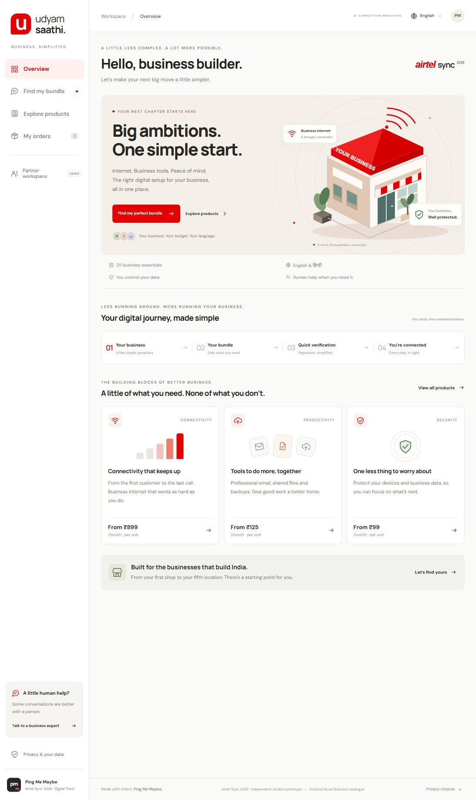
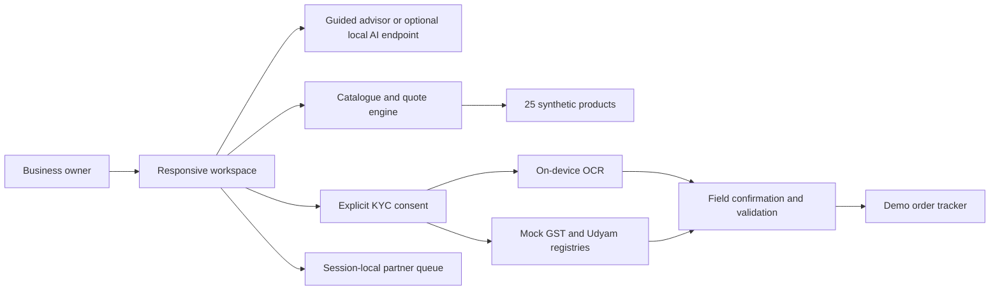

# Udyam Saathi

**A simpler digital start for small businesses.** Built by **Ping Me Maybe** for the Airtel Sync 2026 Digital Track, based on the Project Udyam Digital case.

A business owner describes what they need, gets an itemised bundle, checks their documents and follows the order in one workspace. The design takes its cues from Airtel's red, white and charcoal identity, with original illustrations and a layout built for both phones and desktops.

[Open the private preview](https://ping-me-maybe-udyam-saathi.leafyclef2.chatgpt.site) · ChatGPT sign-in and owner access required.



> This is an independent student prototype. The case uses the fictional operator **Accel Business** and synthetic data. It is not an official Airtel service, and it does not perform real KYC, collect payments or activate connections.

## Run it locally

Install **Node.js 22**, then:

```sh
git clone https://github.com/rizzit17/ping-me-maybe.git
cd ping-me-maybe
npm run dev
```

Open **http://localhost:3000**. There are no npm dependencies to install and no build step. `dist/` contains the actual application source and should remain tracked in Git. Serve it over HTTP; opening `index.html` directly as a file will prevent catalogue loading.

## What works

| Part of the journey | What you can do |
| --- | --- |
| Business discovery | Describe your business in English or Hindi, or edit the guided profile: business type, team size, locations, city, budget and priorities. |
| Product discovery | Search and filter all 25 supplied products, inspect terms and add eligible products to a bundle. |
| Recommendations and quotes | See catalogue-based recommendations, change quantities and remove products. Monthly charges, setup fees, first-month totals and individual minimum contracts update together. |
| Smart KYC | Give consent, check the mock GST/Udyam registries, upload document images and review text extracted on your device. |
| Validation | Check GSTIN checksums, registration status, product dependencies, ID expiry, address-proof age and business-name mismatches. |
| Order tracking | Submit a demo order, download a summary and advance the explicitly simulated activation stages. |
| Partner assistance | Add a request to the session-local partner queue and inspect segment results calculated from the synthetic leads. |

Hindi support covers the advisor conversation, business choices and key journey prompts. The entire interface has not been translated.

## Try the prototype

### 1. Get a quote

Select **Find my perfect bundle** and enter:

```text
I run a clinic in Delhi with 5 staff and budget 3500, no GST
```

Choose **Show my recommendations**. With the default reliability priority, the quote is:

| Product | Quantity | Monthly charge |
| --- | ---: | ---: |
| Biz Fibre 300 | 1 site | ₹1,499 |
| Backup 4G/5G Failover | 1 site | ₹499 |
| Cloud Email & Office Suite | 5 users | ₹625 |
| Endpoint Security | 5 devices | ₹495 |
| **Total** | | **₹3,118** |

The bundle also has **₹1,500 in one-time setup fees**, a **₹4,618 first-month-plus-setup total**, and a longest minimum contract of **12 months**. Taxes are excluded. Prices use the lower end of the supplied catalogue ranges; they are not verified Airtel prices.

Try removing the internet connection while keeping failover. The dependency check should block checkout until the bundle is corrected.

### 2. Check the document flow

Accept a valid quote, then give KYC consent. **Load sample** selects fictional applicant **K03: Ganesh Woodcraft** from the mock registries. **Load sample documents** reads the supplied K03 signatory ID and address proof with on-device OCR.

The sample is a separate document-testing fixture, not the clinic owner's identity from the pricing example. Review the original images before confirming the extracted fields:

- Signatory: **Joseph Singh**; ID valid until **4 July 2028**.
- Business: **Ganesh Woodcraft**.
- Address proof issued **30 May 2026**, evaluated against the case date of **15 July 2026**.

After confirmation, submit the demo order and follow it in **My orders**. Use **Simulate next step** to advance it. No real services are provisioned.

OCR needs an internet connection to load Tesseract.js and its English language model. If loading fails or processing exceeds 25 seconds, the interface offers manual review. Uploaded images are processed in the browser, not sent to the advisor.

## Optional live AI advisor

The default advisor is labelled **Catalogue-guided demo**. It uses local rules and works without an API key.

To enable live language-model responses on the local Node server:

1. Copy `.env.example` to `.env`.
2. Add your own `OPENAI_API_KEY`.
3. Optionally set `OPENAI_MODEL` to a model available to your account; the default is `gpt-4.1-mini`.
4. Restart `npm run dev`.

The server calls the Responses API through `/api/advisor`. The credential stays in the server environment, and `.env` is ignored by Git. API usage may incur charges. Requests are capped at 15 per minute per local client.

The language model explains and discusses needs. **The catalogue engine controls prices and eligibility**, including in live AI mode. Documents are not attached to advisor requests. Avoid entering identity numbers or document contents into chat.

The hosted static preview runs in guided mode. A live hosted advisor requires a separately deployed backend with server-side secrets; static hosting does not execute `server.mjs`.

## How it is put together

The frontend uses native ES modules, HTML and CSS. The local server uses Node's built-in HTTP and filesystem modules. No framework, bundler, package installation or database is required.



```text
.
├── dist/                    # Deployable app source; no build required
│   ├── app.js               # Screens, navigation and session state
│   ├── engine.js            # Quotes, recommendations and validation
│   ├── styles.css           # Responsive visual design
│   └── data/                # Browser JSON and 47 specimen images
├── data/source/             # Original synthetic competition CSVs
├── scripts/prepare-data.py  # Rebuild browser JSON and segment insights
├── server.mjs               # Local server and optional AI endpoint
├── tests/engine.test.mjs    # Catalogue, registry and KYC tests
└── docs/                   # Demo guide, privacy note and screenshot
```

## Checks and data preparation

```sh
npm run check
npm test
```

The 17 tests cover all 3,534 supplied GSTIN checksums, cancelled/suspended registrations, recommendation eligibility across business profiles, quote arithmetic, product dependencies, invalid quantities, document dates and name mismatches. The full sample journey was also exercised in the browser, including a phone-width layout and on-device OCR.

To regenerate the browser data after editing the source CSVs:

```sh
python scripts/prepare-data.py
```

Python 3.9+ is only needed for this preparation step. See [the data notes](data/README.md) for provenance, schema conventions and synthetic-data baselines.

## Privacy and prototype limits

Business discovery runs without KYC consent. Registration inputs and document handling become available only after consent. Images, extracted fields, identifiers and consent stay in the tab's memory; refreshing clears them. Non-identifying preferences and demo order line items use session storage. **Privacy → Clear all session data** clears those too.

The optional AI receives the owner's message and basic preferences, not KYC documents. OCR software and language files load from public CDNs; fonts load from Google Fonts. These services receive normal request metadata.

This prototype does not connect to government registries, DigiLocker, e-sign, payments, WhatsApp, live sales systems or Airtel provisioning. Manual document confirmation is a demo review step, not proof of identity or legal compliance. Physical installation remains subject to serviceability and catalogue lead times. Conversion figures in the partner workspace describe the supplied synthetic dataset, not improvements achieved by this product.

Read the [privacy and security design note](docs/PRIVACY.md) for the full choices and boundaries.

## Demo and submission

[The three-minute demo guide](docs/DEMO.md) covers the recommended recording flow and exception examples. The remaining competition deliverables are the final seven-slide PPT/PDF and a demo video of up to three minutes. Use `PingMeMaybe_CampusName` once the campus name is confirmed.

**Team Ping Me Maybe · Airtel Sync 2026 · Digital Track**
